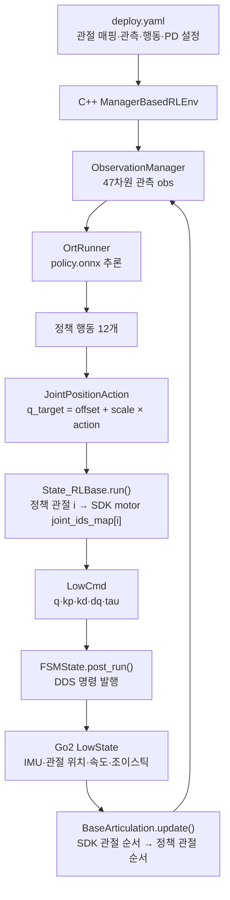

# Go2 sim2real 매핑 구조

이 문서는 현재 저장소의 **Go2 Flat 정책을 C++ 배포 프로그램에서 실행하는 연결 구조**를 설명한다. 학습 파이프라인은 [kante_.md](kante_.md)에 정리되어 있다. 아래 인덱스는 모두 0부터 시작한다.

핵심 설정은 [deploy.yaml](deploy/robots/go2/config/policy/velocity/v0/params/deploy.yaml)이다. 이 파일에서 정책 관절과 SDK 모터의 대응 관계, 기본 자세, 행동 배율, PD 이득, 관측 순서와 추론 주기를 지정한다. 현재 배포 설정은 Actor 관측 47개와 행동 12개를 사용하는 Flat 정책용이다. Rough 정책에 필요한 지형 스캔 187개는 구성되어 있지 않다.

## 1. 파일별 역할

| 파일 | 담당 역할 |
|---|---|
| [deploy.yaml](deploy/robots/go2/config/policy/velocity/v0/params/deploy.yaml) | 관절 매핑·관측·행동·PD·추론 주기 설정 |
| [Go2 config.yaml](deploy/robots/go2/config/config.yaml) | Passive·FixStand·Velocity 상태, 조작 전환 조건, 정책 디렉터리 선택 |
| [main.cpp](deploy/robots/go2/main.cpp) | 네트워크 인터페이스로 DDS 초기화, Go2 상태 수신과 명령 발행 객체 생성, FSM 시작 |
| [unitree_articulation.h](deploy/include/unitree_articulation.h) | IMU·관절 상태 수신, 중력 방향 계산, SDK 관절 상태를 정책 순서로 재정렬 |
| [observations.h](deploy/include/isaaclab/envs/mdp/observations/observations.h) | 정책에 전달할 개별 관측 계산 |
| [observation_manager.h](deploy/include/isaaclab/manager/observation_manager.h) | YAML 순서에 따른 관측 연결, scale·clip·history 처리 |
| [manager_based_rl_env.h](deploy/include/isaaclab/envs/manager_based_rl_env.h) | 상태 갱신 → 관측 생성 → ONNX 추론 → 행동 처리 |
| [algorithms.h](deploy/include/isaaclab/algorithms/algorithms.h) | ONNX Runtime으로 정책 로드·추론 |
| [joint_actions.h](deploy/include/isaaclab/envs/mdp/actions/joint_actions.h) | 행동에 scale·offset을 적용해 목표 관절각 생성 |
| [Go2 State_RLBase.cpp](deploy/robots/go2/src/State_RLBase.cpp) | YAML·ONNX 로드, 목표 관절각을 SDK 모터 번호에 맞게 기록 |
| [공통 State_RLBase.h](deploy/include/FSM/State_RLBase.h) | PD 이득 설정, 별도 정책 추론 스레드 시작·종료 |
| [CtrlFSM.h](deploy/include/FSM/CtrlFSM.h), [FSMState.h](deploy/include/FSM/FSMState.h) | 상태 전환과 주기적 모터 명령 발행 |
| [terminations.h](deploy/include/isaaclab/envs/mdp/terminations.h) | 배포 시 기울기 검사 함수. 현재 미작동 상태는 8절 참고 |

공통 C++ 코드의 `isaaclab` 디렉터리·네임스페이스는 기존 이름이다. Python 학습 쪽의 mjlab 환경과는 별개의 배포 구현이므로 양쪽 설정을 대조해야 한다.

## 2. 전체 데이터 흐름



프로그램 시작 시 `State_RLBase` 생성자가 배포 YAML과 ONNX를 읽는다. Velocity 상태에 들어가면 `enter()`가 이득을 설정하고 정책 스레드를 시작한다. 정책 스레드는 관측과 새 목표 관절각을 계산하고, FSM 루프는 처리된 목표를 모터 명령에 넣어 발행한다.

## 3. 관절 번호 매핑

```yaml
joint_ids_map: [3, 4, 5, 0, 1, 2, 9, 10, 11, 6, 7, 8]
```

의미는 **joint_ids_map[정책 인덱스] = SDK 모터 인덱스**다.

- 정책 순서: `FL → FR → RL → RR`.
- SDK 순서: `FR → FL → RR → RL`.
- 각 다리 내부 순서: `hip → thigh → calf`.
- FL/FR은 앞왼쪽/앞오른쪽, RL/RR은 뒤왼쪽/뒤오른쪽이다.

| 정책 인덱스 | 관절 | SDK 모터 인덱스 | 기본 관절각(rad) |
|---:|---|---:|---:|
| 0 | FL hip | 3 | -0.1 |
| 1 | FL thigh | 4 | 0.9 |
| 2 | FL calf | 5 | -1.8 |
| 3 | FR hip | 0 | 0.1 |
| 4 | FR thigh | 1 | 0.9 |
| 5 | FR calf | 2 | -1.8 |
| 6 | RL hip | 9 | -0.1 |
| 7 | RL thigh | 10 | 0.9 |
| 8 | RL calf | 11 | -1.8 |
| 9 | RR hip | 6 | 0.1 |
| 10 | RR thigh | 7 | 0.9 |
| 11 | RR calf | 8 | -1.8 |

입력과 출력은 같은 배열을 양방향으로 사용한다.

```cpp
// 입력: unitree_articulation.h, BaseArticulation::update()
joint_pos[i] = motor_state[joint_ids_map[i]].q;
joint_vel[i] = motor_state[joint_ids_map[i]].dq;

// 출력: Go2 State_RLBase.cpp, State_RLBase::run()
motor_cmd[joint_ids_map[i]].q = processed_action[i];
```

위 코드는 흐름을 줄여 쓴 의사코드다. 예를 들어 정책의 0번 FL hip 관측은 SDK 3번 모터에서 읽고, 정책의 0번 행동을 변환한 목표 관절각도 SDK 3번 모터에 기록한다. 현재 이 매핑은 순서를 바꾸며, 관절각의 부호를 뒤집거나 단위를 바꾸지는 않는다.

## 4. 실제 센서에서 47차원 관측 만들기

배포 YAML의 `observations` 나열 순서가 정책 입력 벡터 순서가 된다. 학습 설정은 [Python observations.py](src/tasks/go2/step_02_learning/observations.py), 배포 계산은 [C++ observations.h](deploy/include/isaaclab/envs/mdp/observations/observations.h)에서 확인한다.

| 입력 인덱스 | 학습 이름 → 배포 이름 | 차원 | 배포 시 계산 |
|---|---|---:|---|
| 0–2 | `base_ang_vel → base_ang_vel` | 3 | IMU gyroscope 값 |
| 3–5 | `projected_gravity → projected_gravity` | 3 | 몸체 좌표계로 변환한 중력 방향 |
| 6–8 | `command → velocity_commands` | 3 | 조이스틱의 전후·좌우·회전 명령 |
| 9–10 | `phase → gait_phase` | 2 | 보행 위상의 sin/cos |
| 11–22 | `joint_pos → joint_pos_rel` | 12 | 재정렬한 관절각 − 기본 관절각 |
| 23–34 | `joint_vel → joint_vel_rel` | 12 | 재정렬한 관절 속도. 현재 기본 관절 속도는 0 |
| 35–46 | `actions → last_action` | 12 | scale·offset 적용 전의 이전 정책 행동 |
| **합계** | | **47** | ONNX 입력 이름 `obs` |

현재 모든 항목의 관측 scale은 1, clip은 null, history_length는 1이다. C++에서 추가 학습 노이즈를 넣지 않으며, 내보낸 ONNX 그래프 안의 관측 정규화는 추론 과정에서 적용된다. 학습용 Critic의 74차원 입력은 배포에 사용하지 않는다.

### IMU와 중력 방향

`BaseArticulation::update()`는 SDK quaternion을 `[w, x, y, z]` 순서로 해석하고, 그 켤레 회전으로 월드의 단위 중력 벡터 `[0, 0, -1]`을 몸체 좌표계로 변환한다. 가속도계 측정값을 이 관측에 직접 넣는 구조는 아니다.

### 조이스틱 명령

`velocity_commands()`는 다음처럼 처리한다.

```text
vx = clamp( ly, -0.5,  1.0)
vy = clamp(-lx, -0.5,  0.5)
wz = clamp(-rx, -1.0,  1.0)
```

현재 구현은 조이스틱 값을 범위로 제한하며, 전체 조이스틱 범위를 새 속도 범위로 비례 확대하는 연산은 하지 않는다. 학습 중 사용하는 무작위·heading 명령 대신 사용자가 준 속도 명령을 전달한다.

### 보행 위상

보행 주기는 `0.6초`이며 명령 벡터의 3차원 노름이 `0.1`보다 작으면 sin/cos 관측을 모두 0으로 만든다. C++ 구현은 관측 함수가 호출될 때마다 `step_dt / period`만큼 위상을 증가시킨다. 학습 구현과 초기 위상이 달라질 수 있는 점은 8절에 기록했다.

## 5. 정책 행동을 모터 명령으로 변환하기

[joint_actions.h](deploy/include/isaaclab/envs/mdp/actions/joint_actions.h)의 `JointAction::process_actions()`가 각 정책 행동에 다음 변환을 적용한다.

```text
q_target[i] = offset[i] + scale[i] × action[i]
            = 기본 관절각[i] + 0.25 × action[i]
```

YAML의 `offset`과 `default_joint_pos`는 현재 같은 값이며 둘 다 **정책 관절 순서**다. 전자는 출력 목표 자세를, 후자는 입력의 상대 관절각 기준을 정한다.

예를 들어 정책 0번 행동이 `0.4`이면 FL hip 목표는 `-0.1 + 0.25 × 0.4 = 0rad`이고, 이 값이 SDK 3번 모터의 `q`에 들어간다. 현재 `clip: null`이므로 이 처리 단계는 행동을 ±1로 제한하거나 목표 관절각을 별도로 제한하지 않는다.

학습 쪽 [actions.py](src/tasks/go2/step_01_environment/actions.py)도 배율 0.25와 기본 자세 offset을 사용한다. 학습 환경에서 랜덤화한 `encoder_bias`는 mjlab이 제어 목표에서 빼지만, 이 C++ 배포 코드에는 별도의 encoder bias 보정 항이 없다.

### PD 이득은 SDK 순서

[State_RLBase.h](deploy/include/FSM/State_RLBase.h)의 `enter()`는 아래 값을 `motor_cmd()[i]`에 직접 넣는다. **stiffness/damping 배열에는 joint_ids_map을 적용하지 않는다.**

| YAML 값 | 배열 순서 | 사용 위치 |
|---|---|---|
| `default_joint_pos`, 행동 `offset/scale` | 정책 순서 | 상대 관절각 계산·행동 변환 |
| `stiffness`, `damping` | SDK 모터 순서 | 모터 명령의 kp·kd |

현재 PD 설정은 모든 다리에 공통으로 hip/thigh/calf의 Kp가 `20/20/40`, Kd가 `1/1/2`다. 다리마다 같은 값이라 순서 차이가 수치에 드러나지 않는다. 다리별 이득을 다르게 설정할 때는 SDK 순서로 작성해야 한다.

Velocity 진입 시 목표 속도 `dq=0`, 추가 토크 `tau=0`도 설정한다. 정책은 목표 관절각을 출력하고 kp·kd가 함께 전달된다. 학습 모델의 토크 제한 설정이 이 경로에서 자동으로 전송되는 것은 아니다.

### 추론 주기와 명령 발행 주기

| 구분 | 현재 설정 | 근거 |
|---|---|---|
| 학습 물리 스텝 | 0.005초, 200Hz | [base_env.py](src/tasks/go2/step_01_environment/base_env.py) |
| 학습 정책 스텝 | decimation 4 → 0.02초, 50Hz | 같은 환경 설정 |
| C++ 정책 추론 | step_dt 0.02초, 명목 50Hz | deploy.yaml + State_RLBase.h의 정책 스레드 |
| PC 측 FSM·명령 발행 | 0.001초, 명목 1,000Hz | CtrlFSM.h의 dt + FSMState.h의 post_run |

정책 추론과 명령 발행은 별도 루프다. 새 추론 결과가 준비될 때 목표가 갱신되고, FSM은 처리된 목표를 반복해서 발행한다. 표의 C++ 주기는 코드의 스케줄 설정이며 실제 지연을 측정한 결과나 로봇 내부 PD 제어 주파수는 아니다.

## 6. 학습 ONNX와 배포 설정 연결

학습 시 [runner.py](src/tasks/go2/step_03_training/runner.py)가 로그 폴더에 `policy.onnx`를 내보내고 관절 이름·제어 설정 등의 메타데이터를 붙인다.

Go2 배포 코드가 기대하는 정책 디렉터리 구조는 다음과 같다.

```text
deploy/robots/go2/config/policy/velocity/v0/
├── params/
│   └── deploy.yaml
└── exported/
    └── policy.onnx
```

외부 데이터 파일을 사용하는 ONNX를 내보냈다면 그 파일도 모델이 참조하는 상대 경로에 함께 둬야 한다. 모든 ONNX가 `policy.onnx.data`를 별도로 생성하는 것은 아니다.

[config.yaml](deploy/robots/go2/config/config.yaml)의 `FSM.Velocity.policy_dir`는 `config/policy/velocity`다. [param.h](deploy/include/param.h)의 `parser_policy_dir()`는 직접 지정한 경로에 exported 폴더가 없으면, 하위 디렉터리를 이름순으로 정렬한 뒤 뒤에서부터 exported 폴더가 있는 버전을 고른다. 수정 시각이나 학습 성능으로 선택하지 않는다.

**배포 YAML은 ONNX 메타데이터에서 자동 생성되거나 갱신되지 않는다.** C++은 YAML과 ONNX를 별도로 읽고, `OrtRunner`는 ONNX의 입력·출력 이름과 shape를 사용해 추론한다. 관절 매핑·관측 구성·offset·PD는 YAML에서 관리한다. ONNX 안의 관측 정규화와 배포 YAML의 관측 scale도 서로 다른 처리다.

학습 모델을 바꿀 때는 ONNX와 함께 다음 대응을 확인한다.

| 학습에서 바뀐 내용 | 함께 확인할 배포 설정 |
|---|---|
| 관절 순서·로봇 모델 | joint_ids_map과 기본 자세, SDK 순서의 PD 배열 |
| 관측 항목·순서·이력 | observations 나열과 C++ 관측 함수, ONNX 입력 차원 |
| 기본 자세 | default_joint_pos와 행동 offset |
| 행동 배율 | actions.JointPositionAction.scale |
| 보행 주기 | gait_phase.params.period |
| 정책 시간 간격 | step_dt |
| 속도 명령 범위 | commands.base_velocity.ranges와 조이스틱 처리 |
| Flat → Rough | 지형 스캔 입력과 계산을 추가해야 하며 ONNX 교체만으로 연결되지 않음 |

## 7. 시뮬레이션 배포와 실기 연결

C++ 배포 프로그램의 네트워크 인터페이스는 [main.cpp](deploy/robots/go2/main.cpp)에서 `--network` 인자로 받는다. 시뮬레이션에서는 `lo`, 실기에서는 로봇에 연결한 실제 인터페이스를 사용한다.

[simulate/config.yaml](simulate/config.yaml)은 Go2 모델과 시뮬레이터 DDS 인터페이스를 선택한다. [unitree_sdk2_bridge.h](simulate/src/unitree_sdk2_bridge.h)는 MuJoCo의 관절·IMU 데이터를 Go2 LowState 형식으로 발행하고, 받은 LowCmd의 q·kp·kd·dq·tau로 시뮬레이션 제어 입력을 만든다.

```text
실기:       C++ 배포 프로그램 ↔ DDS ↔ Go2
통신 검증:  C++ 배포 프로그램 ↔ DDS ↔ MuJoCo SDK 브리지
Python 재생: scripts/play.py → mjlab 환경에서 체크포인트 추론
```

Python `play.py`로 정책을 재생하는 것과 C++/DDS 경로를 검증하는 것은 범위가 다르다. 브리지는 모터·센서 배열의 인덱스를 직접 사용하므로 시뮬레이션 모델의 배열 순서도 별도로 맞아야 한다. 설치·빌드 안내는 [README.md](README.md)의 Real Deployment 절에 있다.

## 8. 현재 확인 상태와 남은 문제

2026-09-30 문서 작성 기준으로 소스에서 확인한 상태다.

| 항목 | 상태 |
|---|---|
| 기본 매핑 설정 | Flat의 관측 47개, 행동 12개, 기본 자세, 배율 0.25, 보행 주기 0.6초, 추론 주기 0.02초, PD 수치 대조 완료 |
| 배포 모델 배치 | 현재 v0에는 params/deploy.yaml만 있으며 exported/policy.onnx는 아직 없음 |
| Python 학습 | 앞서 Flat에서 환경 8개·수집 8스텝·3회 PPO 업데이트와 ONNX 내보내기를 확인. 상세 기록은 kante_.md 참고 |
| C++·실기 검증 | C++ 배포 프로그램과 실제 Go2의 실행 검증은 완료하지 않음 |
| 기울기에 따른 Passive 전환 | 아래 bad_orientation 구현 때문에 현재 작동하지 않음 |
| 위상 초기화 | 학습과 배포에서 위상을 갱신하는 기준에 차이가 있음 |

### 기울기 검사 미작동

[terminations.h](deploy/include/isaaclab/envs/mdp/terminations.h)의 현재 구현은 다음과 같다.

```cpp
// return std::fabs(std::acos(-data[2])) > limit_angle;
return false;
```

Go2 `State_RLBase`에 `bad_orientation(env.get(), 1.0)`이면 Passive로 전환하는 조건이 등록되어 있지만, 함수가 항상 false를 반환하므로 기울기에 따른 전환은 발생하지 않는다. 조이스틱이나 통신 timeout에 의한 전환 조건과는 별개다. 이 문서는 해당 문제를 기록하며 코드를 수정한 것은 아니다.

### 보행 위상 초기화 차이

[학습 phase()](src/tasks/go2/step_02_learning/mdp/observations.py)는 에피소드 스텝 수와 step_dt로 위상을 계산한다. C++ `gait_phase()`는 호출할 때마다 위상을 전진시키므로 reset에서 관측을 구성할 때도 증가한다. 주기와 정지 조건은 같지만 초기 위상이 완전히 같다고 가정하면 안 된다.

이 문서의 확인 범위는 코드와 설정의 대응 관계다. 실제 로봇에서의 통신 지연, 관절 보정, 자세 안정성 및 보행 성능은 별도 실행 검증 대상이다.
